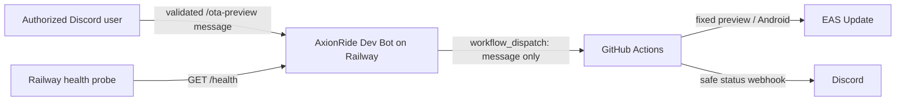

# AxionRide Dev Bot

A small, security-focused Discord bot that can dispatch **Android preview OTA updates only**. Production deployment is intentionally impossible in v1 and requires a later, separate approval design.

## 1. What the bot does

- `/ota-preview message:<text>` dispatches the configured GitHub Actions workflow after authorization, validation, cooldown, and concurrency checks.
- `/status` displays non-sensitive configuration readiness and the last request known by this process.
- `/links` provides configured public project links.
- `/help` explains the preview-only command set.
- `GET /health` returns `{"status":"ok","service":"axionride-dev-bot"}`.

The bot never runs local shell commands and never accepts a channel, environment, or platform from Discord. Codex cannot automatically post to Discord when a prompt finishes. A GitHub push, pull request workflow, or Actions workflow can post status updates through a Discord webhook instead.

## 2. Architecture diagram in Mermaid



## 3. Local setup

Requirements: Node.js 20 or later, npm, a Discord application, and a fine-grained GitHub token. Never paste secrets into source files or chat.

Windows Command Prompt:

```cmd
cd C:\Projects\axionride-dev-bot
copy .env.example .env
npm install
npm run typecheck
npm test
npm run dev
```

Fill `.env` locally; it is ignored by Git. Keep each comma-separated ID list free of quotes. The variables are:

| Variable | Purpose |
|---|---|
| `DISCORD_TOKEN` | Secret bot token from the Discord developer portal. |
| `DISCORD_CLIENT_ID` | Public Discord application ID. |
| `DISCORD_GUILD_ID` | Optional development server ID; enables fast guild command registration. |
| `ALLOWED_DISCORD_USER_IDS` | Comma-separated user IDs authorized to use commands. |
| `ALLOWED_DISCORD_ROLE_IDS` | Comma-separated role IDs authorized to use commands. |
| `GITHUB_TOKEN` | Fine-grained PAT used only for workflow dispatch. |
| `GITHUB_OWNER` | Mobile repository owner; default placeholder is `potatolover-69`. |
| `GITHUB_REPO` | Mobile repository name; default placeholder is `axionride`. |
| `GITHUB_WORKFLOW_FILE` | Workflow filename, normally `preview-ota.yml`. |
| `GITHUB_BRANCH` | Dispatch ref, normally `develop`. |
| `DISCORD_ANNOUNCEMENTS_CHANNEL_ID` | Reserved announcements destination. |
| `DISCORD_BUILD_STATUS_CHANNEL_ID` | Text channel receiving requested-update embeds. |
| `DISCORD_CHANGELOG_CHANNEL_ID` | Reserved changelog destination. |
| `GITHUB_REPOSITORY_URL` | Public HTTPS repository page shown by `/links`. |
| `GITHUB_ACTIONS_URL` | Public HTTPS Actions page shown in replies. |
| `EAS_PROJECT_URL` | Public HTTPS EAS dashboard link. |
| `PORT` | Health server port; Railway supplies this, default `3000`. |

Startup validates required values without printing their contents. At least one allowed user ID or role ID is required.

## 4. Create Discord application and bot

1. In the Discord Developer Portal, create an application named **AxionRide Dev Bot**.
2. Open **Bot**, create the bot, and reset/copy its token directly into your local `.env` or Railway secret variable.
3. Do not enable privileged intents; this bot needs only the `Guilds` intent.
4. Copy the Application ID into `DISCORD_CLIENT_ID`.

## 5. Invite bot with correct scopes

In **OAuth2 > URL Generator**, select exactly these scopes:

- `bot`
- `applications.commands`

Grant only **View Channels**, **Send Messages**, and **Embed Links** in the build-status channel. Open the generated URL and choose your server.

## 6. How to get Discord User ID and Role ID

Enable **User Settings > Advanced > Developer Mode**. Right-click a user and choose **Copy User ID**. Under **Server Settings > Roles**, right-click a role and choose **Copy Role ID**. Put comma-separated IDs into the allow-list variables. Authorization succeeds when either the user or one of their roles is allowed.

## 7. How to configure Discord channels

With Developer Mode enabled, right-click each channel and choose **Copy Channel ID**. Configure the three channel variables. The bot currently posts OTA request embeds only to `DISCORD_BUILD_STATUS_CHANNEL_ID`; the other two IDs are reserved for safe future announcement features.

## 8. How to create a fine-grained GitHub token with only the minimum Actions/workflow-dispatch access needed

In GitHub **Settings > Developer settings > Personal access tokens > Fine-grained tokens**, select only the AxionRide mobile repository, choose a short expiration, and grant repository **Actions: Read and write**. Leave all unrelated permissions at no access. Store the token only as `GITHUB_TOKEN` in local/Railway environment variables. Rotate it if exposed. Organization policy may require an administrator to approve the token.

## 9. How to set GitHub repository secrets

In the **AxionRide mobile repository** (not this bot repository), open **Settings > Secrets and variables > Actions** and create:

- `EXPO_TOKEN` — EAS authentication used by the update step.
- `DISCORD_WEBHOOK_URL` — webhook for success/failure notifications.

Use GitHub secrets, never workflow text, repository variables, logs, or source code.

## 10. How to obtain Expo token safely

Sign in to the Expo website, open account settings, create a personal access token with the narrowest suitable access, and copy it directly into the GitHub `EXPO_TOKEN` secret. Do not put it in `.env`, commit it, paste it into Discord, or print it. Revoke and replace it if exposed.

## 11. How to copy the workflow into the AxionRide repository

This repository includes [`.github/workflows/preview-ota.yml`](.github/workflows/preview-ota.yml) as a reviewed template. Copy it manually to this exact mobile-app location:

```text
C:\Projects\axionride\.github\workflows\preview-ota.yml
```

Windows Command Prompt (run only when you intentionally want to modify the mobile repository):

```cmd
copy C:\Projects\axionride-dev-bot\.github\workflows\preview-ota.yml C:\Projects\axionride\.github\workflows\preview-ota.yml
```

The bot setup does **not** execute this command and does not modify the mobile project. The workflow has only `workflow_dispatch`, one `message` input, checkout of `develop`, and fixed `preview` channel/environment plus `android` platform. Confirm the mobile project has a committed npm lockfile because the workflow uses `npm ci`.

## 12. How to deploy to Railway

1. Push this bot repository to a private GitHub repository and create a Railway project from it.
2. Add every required `.env.example` variable in Railway **Variables**. Use Railway secret variables for `DISCORD_TOKEN` and `GITHUB_TOKEN`; do not commit `.env`.
3. Railway runs `npm run build`, then use `npm start` as the start command.
4. Configure `/health` as the health-check path.
5. Register commands once using the production variables.

Railway must host the process continuously for slash commands and interactions to work. The bot reads `process.env.PORT` through validated configuration.

## 13. How to register slash commands

For fast testing, set `DISCORD_GUILD_ID`, then run:

```cmd
cd C:\Projects\axionride-dev-bot
npm run register-commands
```

Remove `DISCORD_GUILD_ID` to register global commands; global propagation can take longer. Registration reads credentials from environment variables and does not print them.

## 14. How to test safely

1. Use a test Discord server and keep `GITHUB_WORKFLOW_FILE` pointed to the preview-only workflow.
2. Run `npm run typecheck`, `npm run build`, and `npm test`.
3. Try `/status`, `/links`, and `/help` first.
4. Verify an unlisted account is denied.
5. Dispatch a harmless preview message such as `Test preview update` and confirm the GitHub run targets `develop`, preview, and Android.
6. Confirm the second immediate request is rate-limited and concurrent requests do not both dispatch.
7. Confirm `/health` reveals no configuration.

## 15. Security checklist

- [ ] `.env`, tokens, webhook URLs, Expo credentials, and service keys are never committed.
- [ ] At least one explicit Discord user or role is allowed; broad roles such as `@everyone` are not used.
- [ ] Bot channel permissions are minimal.
- [ ] Fine-grained PAT is repository-scoped, short-lived, and Actions-only.
- [ ] Workflow exists in the mobile repository and still has only a `message` input.
- [ ] GitHub secrets `EXPO_TOKEN` and `DISCORD_WEBHOOK_URL` are configured in the mobile repository.
- [ ] Public button URLs are HTTPS and contain no credentials or signed query strings.
- [ ] Logs and error reports contain no secrets.
- [ ] Production workflows are not referenced by this bot.

In-memory cooldown, dispatch lock, and last-message state reset on restart and are not shared across multiple Railway replicas. Run one bot replica in v1. A successful dispatch means GitHub accepted the request, not that EAS published it; GitHub sends the final webhook status. Discord webhook delivery is best-effort. Production deployment is intentionally deferred.

## 16. How to add future commands safely

Keep the authorization guard before all actions, use fixed allow-listed operations, validate every input, make normal replies ephemeral, and expose no arbitrary command, file path, URL, branch, environment, platform, or workflow name. Add tests for authorization, validation, concurrency, payload shape, and redaction. Any future production feature needs a separate threat model, multi-person approval, audit trail, durable locking, and an independently scoped credential; do not extend `/ota-preview` for production.
