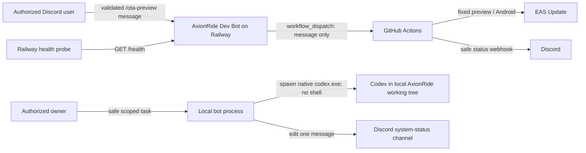

# AxionRide Dev Bot

A small, security-focused Discord bot that can dispatch **Android preview OTA updates only**. Production deployment is intentionally impossible in v1 and requires a later, separate approval design.

## 1. What the bot does

- `/ota-preview message:<text>` dispatches the configured GitHub Actions workflow after authorization, validation, cooldown, and concurrency checks.
- `/status` displays non-sensitive configuration readiness and the last request known by this process.
- `/links` provides configured public project links.
- `/help` explains the preview-only command set.
- `/codex-task`, `/codex-status`, and `/codex-cancel` manage one explicitly enabled, local-PC Codex task at a time.
- `/system-status` refreshes and privately displays the AxionRide control-room status.
- `GET /health` returns `{"status":"ok","service":"axionride-dev-bot"}`.

The bot never runs local shell commands and never accepts a channel, environment, or platform from Discord. Codex cannot automatically post to Discord when a prompt finishes. A GitHub push, pull request workflow, or Actions workflow can post status updates through a Discord webhook instead.

## 2. Architecture diagram in Mermaid



## 3. Local setup

Requirements: Node.js 20 or later, npm, a Discord application, and a fine-grained GitHub token. Never paste secrets into source files or chat.

Windows Command Prompt:

```cmd
cd C:\Projects\axionride-dev-bot
copy .env.example .env
npm install
npm run typecheck
npm test
npm run dev
```

Fill `.env` locally; it is ignored by Git. Keep each comma-separated ID list free of quotes. The variables are:

| Variable | Purpose |
|---|---|
| `DISCORD_TOKEN` | Secret bot token from the Discord developer portal. |
| `DISCORD_CLIENT_ID` | Public Discord application ID. |
| `DISCORD_GUILD_ID` | Optional development server ID; enables fast guild command registration. |
| `ALLOWED_DISCORD_USER_IDS` | Comma-separated user IDs authorized to use commands. |
| `ALLOWED_DISCORD_ROLE_IDS` | Comma-separated role IDs authorized to use commands. |
| `GITHUB_TOKEN` | Fine-grained PAT used only for workflow dispatch. |
| `GITHUB_OWNER` | Mobile repository owner; default placeholder is `potatolover-69`. |
| `GITHUB_REPO` | Mobile repository name; default placeholder is `axionride`. |
| `GITHUB_WORKFLOW_FILE` | Workflow filename, normally `preview-ota.yml`. |
| `GITHUB_BRANCH` | Dispatch ref, normally `develop`. |
| `DISCORD_ANNOUNCEMENTS_CHANNEL_ID` | Reserved announcements destination. |
| `DISCORD_BUILD_STATUS_CHANNEL_ID` | Text channel receiving requested-update embeds. |
| `DISCORD_CHANGELOG_CHANNEL_ID` | Reserved changelog destination. |
| `DISCORD_PROMPTS_CHANNEL_ID` | Private owner-and-bot-only channel for redacted full Codex prompt history. |
| `DISCORD_AI_OPERATIONS_CHANNEL_ID` | Optional private channel for significant AI cost, trial, renewal, expiry, and resolved alerts. |
| `GITHUB_REPOSITORY_URL` | Public HTTPS repository page shown by `/links`. |
| `GITHUB_ACTIONS_URL` | Public HTTPS Actions page shown in replies. |
| `EAS_PROJECT_URL` | Public HTTPS EAS dashboard link. |
| `PORT` | Health server port; Railway supplies this, default `3000`. |
| `LOCAL_CODEX_RUNNER_ENABLED` | Explicit local-only feature flag; defaults to `false` and must remain false on Railway. |
| `CODEX_EXECUTABLE` | Absolute path to the native `codex.exe`; command wrappers are rejected. |
| `AXIONRIDE_REPO_PATH` | Fixed local working tree, normally `C:\Projects\axionride`. |
| `CODEX_TASK_TIMEOUT_MINUTES` | Hard task timeout, default 45 and maximum 180. |
| `CODEX_TASK_COOLDOWN_SECONDS` | Per-user queue cooldown, minimum/default 60 seconds. |
| `DISCORD_SYSTEM_STATUS_CHANNEL_ID` | Dedicated channel containing one edit-in-place control-room message. |
| `SYSTEM_STATUS_INTERVAL_SECONDS` | Refresh interval; default 60 and minimum 30 seconds. |
| `SUPABASE_HEALTH_URL` | Optional public provider/health URL without credentials. |
| `EXPO_STATUS_URL` | Optional public Expo/EAS provider status URL. |
| `GITHUB_STATUS_URL` | Optional public GitHub provider status URL. |
| `RAILWAY_HEALTH_URL` | Optional public bot health endpoint. |

Startup validates required values without printing their contents. At least one allowed user ID or role ID is required.

## 4. Create Discord application and bot

1. In the Discord Developer Portal, create an application named **AxionRide Dev Bot**.
2. Open **Bot**, create the bot, and reset/copy its token directly into your local `.env` or Railway secret variable.
3. Do not enable privileged intents; this bot needs only the `Guilds` intent.
4. Copy the Application ID into `DISCORD_CLIENT_ID`.

## 5. Invite bot with correct scopes

In **OAuth2 > URL Generator**, select exactly these scopes:

- `bot`
- `applications.commands`

Grant only **View Channels**, **Send Messages**, and **Embed Links** in the build-status channel. Open the generated URL and choose your server.

## 6. How to get Discord User ID and Role ID

Enable **User Settings > Advanced > Developer Mode**. Right-click a user and choose **Copy User ID**. Under **Server Settings > Roles**, right-click a role and choose **Copy Role ID**. Put comma-separated IDs into the allow-list variables. Authorization succeeds when either the user or one of their roles is allowed.

## 7. How to configure Discord channels

With Developer Mode enabled, right-click each channel and choose **Copy Channel ID**. Configure the channel variables. `DISCORD_BUILD_STATUS_CHANNEL_ID` receives operational task/OTA events, `DISCORD_PROMPTS_CHANNEL_ID` receives private redacted Codex prompt history, and the changelog webhook receives polished successful Preview OTA notes.

## 8. How to create a fine-grained GitHub token with only the minimum Actions/workflow-dispatch access needed

In GitHub **Settings > Developer settings > Personal access tokens > Fine-grained tokens**, select only the AxionRide mobile repository, choose a short expiration, and grant repository **Actions: Read and write**. Leave all unrelated permissions at no access. Store the token only as `GITHUB_TOKEN` in local/Railway environment variables. Rotate it if exposed. Organization policy may require an administrator to approve the token.

## 9. How to set GitHub repository secrets

In the **AxionRide mobile repository** (not this bot repository), open **Settings > Secrets and variables > Actions** and create:

- `EXPO_TOKEN` — EAS authentication used by the update step.
- `DISCORD_WEBHOOK_URL` — webhook for success/failure notifications.
- `DISCORD_CHANGELOG_WEBHOOK_URL` — optional webhook for successful Preview OTA changelog entries only.

Use GitHub secrets, never workflow text, repository variables, logs, or source code.

## 10. How to obtain Expo token safely

Sign in to the Expo website, open account settings, create a personal access token with the narrowest suitable access, and copy it directly into the GitHub `EXPO_TOKEN` secret. Do not put it in `.env`, commit it, paste it into Discord, or print it. Revoke and replace it if exposed.

## 11. How to copy the workflow into the AxionRide repository

This repository includes [`.github/workflows/preview-ota.yml`](.github/workflows/preview-ota.yml) as a reviewed template. Copy it manually to this exact mobile-app location:

```text
C:\Projects\axionride\.github\workflows\preview-ota.yml
```

Windows Command Prompt (run only when you intentionally want to modify the mobile repository):

```cmd
copy C:\Projects\axionride-dev-bot\.github\workflows\preview-ota.yml C:\Projects\axionride\.github\workflows\preview-ota.yml
```

The bot setup does **not** execute this command and does not modify the mobile project. The workflow has only `workflow_dispatch`, a required `message` input and optional `release_notes` input, checkout of `develop`, and fixed `preview` channel/environment plus `android` platform. Confirm the mobile project has a committed npm lockfile because the workflow uses `npm ci`.

## 12. How to deploy to Railway

1. Push this bot repository to a private GitHub repository and create a Railway project from it.
2. Add every required `.env.example` variable in Railway **Variables**. Use Railway secret variables for `DISCORD_TOKEN` and `GITHUB_TOKEN`; do not commit `.env`.
3. Railway runs `npm run build`, then use `npm start` as the start command.
4. Configure `/health` as the health-check path.
5. Register commands once using the production variables.

Railway must host the process continuously for slash commands and interactions to work. The bot reads `process.env.PORT` through validated configuration.

The local Codex runner must **not** run on Railway. Keep `LOCAL_CODEX_RUNNER_ENABLED=false` there. Run the bot on this Windows PC when you want `/codex-task`; only that local process has access to the configured working tree.

## 13. How to register slash commands

For fast testing, set `DISCORD_GUILD_ID`, then run:

```cmd
cd C:\Projects\axionride-dev-bot
npm run register-commands
```

Remove `DISCORD_GUILD_ID` to register global commands; global propagation can take longer. Registration reads credentials from environment variables and does not print them.

## 14. How to test safely

1. Use a test Discord server and keep `GITHUB_WORKFLOW_FILE` pointed to the preview-only workflow.
2. Run `npm run typecheck`, `npm run build`, and `npm test`.
3. Try `/status`, `/links`, and `/help` first.
4. Verify an unlisted account is denied.
5. Dispatch a harmless preview message such as `Test preview update` and confirm the GitHub run targets `develop`, preview, and Android.
6. Confirm the second immediate request is rate-limited and concurrent requests do not both dispatch.
7. Confirm `/health` reveals no configuration.

## 15. Security checklist

- [ ] `.env`, tokens, webhook URLs, Expo credentials, and service keys are never committed.
- [ ] At least one explicit Discord user or role is allowed; broad roles such as `@everyone` are not used.
- [ ] Bot channel permissions are minimal.
- [ ] Fine-grained PAT is repository-scoped, short-lived, and Actions-only.
- [ ] Workflow exists in the mobile repository and still has only a `message` input.
- [ ] GitHub secrets `EXPO_TOKEN`, `DISCORD_WEBHOOK_URL`, and optional `DISCORD_CHANGELOG_WEBHOOK_URL` are configured in the mobile repository.
- [ ] The `prompts` channel is visible only to the owner and bot.
- [ ] Public button URLs are HTTPS and contain no credentials or signed query strings.
- [ ] Logs and error reports contain no secrets.
- [ ] Production workflows are not referenced by this bot.

In-memory cooldown, dispatch lock, and last-message state reset on restart and are not shared across multiple Railway replicas. Run one bot replica in v1. A successful dispatch means GitHub accepted the request, not that EAS published it; GitHub sends the final webhook status. Discord webhook delivery is best-effort. Production deployment is intentionally deferred.

## 16. How to add future commands safely

Keep the authorization guard before all actions, use fixed allow-listed operations, validate every input, make normal replies ephemeral, and expose no arbitrary command, file path, URL, branch, environment, platform, or workflow name. Add tests for authorization, validation, concurrency, payload shape, and redaction. Any future production feature needs a separate threat model, multi-person approval, audit trail, durable locking, and an independently scoped credential; do not extend `/ota-preview` for production.

## 17. Local Codex runner

The runner is opt-in and local-PC-only. It checks the fixed repository directory, Git working tree, and native Codex executable at startup. It never exposes an HTTP execution endpoint. Discord input is written to Codex stdin; it is never interpolated into a command. Codex runs as a separate child with `shell: false`, fixed arguments, `read-only` sandboxing for clear inspection tasks or `workspace-write` for allowed implementation tasks, no dangerous bypass flags, a stripped environment, one-task locking, cooldown, and a timeout. Redacted exit diagnostics are written only to the ignored local file `logs/codex-runner.log`.

This PC has Codex CLI `0.144.1`. `codex.cmd` is installed, but Node 24 cannot spawn that Windows wrapper with `shell: false`. The native executable discovered and successfully tested here is:

```text
C:\Users\pc\AppData\Roaming\npm\node_modules\@openai\codex\node_modules\@openai\codex-win32-x64\vendor\x86_64-pc-windows-msvc\bin\codex.exe
```

After Codex updates, rediscover and verify it in Windows Command Prompt:

```cmd
where codex
dir /s /b "%APPDATA%\npm\node_modules\@openai\codex\node_modules\@openai\codex-win32-x64\vendor\codex.exe" 2>nul
codex.cmd --version
codex.cmd login
```

Configure the discovered `.exe` path in the ignored `.env`, or enable it for one Command Prompt session without writing secrets:

```cmd
cd C:\Projects\axionride-dev-bot
set LOCAL_CODEX_RUNNER_ENABLED=true
set CODEX_EXECUTABLE=C:\Users\pc\AppData\Roaming\npm\node_modules\@openai\codex\node_modules\@openai\codex-win32-x64\vendor\x86_64-pc-windows-msvc\bin\codex.exe
set AXIONRIDE_REPO_PATH=C:\Projects\axionride
set CODEX_TASK_TIMEOUT_MINUTES=45
set CODEX_TASK_COOLDOWN_SECONDS=60
npm run dev
```

The optional `/codex-task branch:` value must match the current local branch. The bot never switches branches. Only explicitly listed user IDs—not role-only authorization—can cancel a task. Filters reject requests for push, destructive Git operations, secrets, EAS update/build, npm publishing, deployment, and similar destructive operations. Every task receives the mandatory final safety instruction. Changes remain uncommitted for human review; run `/ota-preview` manually only after review.

## 18. System-status channel

Create a dedicated Discord text channel named `system-status`, enable Developer Mode, copy its channel ID, and set `DISCORD_SYSTEM_STATUS_CHANNEL_ID`. Give the bot only **View Channel**, **Read Message History**, **Send Messages**, and **Embed Links** there. Read Message History lets it find and reuse its control-room message after restart. It does not need Administrator, Manage Server, Manage Channels, or Manage Messages.

The bot finds its existing **AxionRide Control Room** embed and edits it every 60 seconds by default. Missing optional URLs display Unknown. GitHub Actions lookup reuses the current token only when it already has Actions read access; insufficient access displays Unknown and does not require broader permissions. Public Supabase and Expo checks measure provider/endpoint reachability only—not whether AxionRide works. Configure only public HTTPS URLs without keys, signed parameters, or credentials.

The bot cannot detect or report its own downtime while offline. A future external monitor such as UptimeRobot should poll `/health` and alert Discord independently when the local bot or Railway endpoint is unavailable. The bot enforces a 30-second minimum status interval and defaults to 60 seconds.

## 19. Private prompt history and Preview changelog

Create a Discord text channel named `prompts`. Deny **View Channel** to `@everyone`, then allow it only for your owner account and the AxionRide bot. Give the bot View Channel, Send Messages, Embed Links, and Read Message History. Copy the channel ID into local `.env` as `DISCORD_PROMPTS_CHANNEL_ID`; add the same variable in Railway later only if that bot instance should retain prompt history. Never make this channel public: accepted Codex prompts are stored there after likely tokens, API keys, passwords, and `.env` assignment values are replaced with `[REDACTED]`.

Each accepted `/codex-task` creates one prompt-history embed with task ID, requester, branch, timestamp, full redacted prompt, and Queued state. The same message is edited to Running and then Completed, Failed, or Cancelled with duration and a safe summary. Unauthorized and rejected prompts are not posted. Raw terminal output, authentication files, and environment objects are never sent.

For `changelog`, open **Edit Channel > Integrations > Webhooks**, create a dedicated webhook, and copy its URL directly into the AxionRide mobile repository Actions secret named `DISCORD_CHANGELOG_WEBHOOK_URL`. Do not place the webhook URL in bot source, `.env.example`, or a GitHub variable. The existing `DISCORD_WEBHOOK_URL` remains for build-status success/failure notifications; the changelog webhook runs only after a successful EAS Preview update. If it is missing, the workflow prints a safe skip notice and still succeeds.

`/ota-preview` accepts optional `release_notes` up to 1000 safe characters. These appear as **What changed** in the successful changelog; when omitted, the short OTA message is used. The workflow does not infer or invent features from code. If a safe public EAS project/results URL is configured as the GitHub Actions variable `EAS_PROJECT_URL`, it is included; otherwise that field is omitted.

The `build-status` channel is operational and may include queued, working, success, and failure events. The `changelog` channel is release-facing and receives polished successful Preview OTA entries only. A successful Preview OTA updates the preview channel for testers; it is **not** a public Google Play Store release and adds no production deployment capability.

## 20. AI Operations Monitoring (Milestone 18)

AI Operations is a generic developer-only registry for user-defined providers, agents, tools, usage records, subscriptions, trials, and cost-risk thresholds. It contains no provider-specific business logic. All providers are manual-only in v1. An API-mode agent is labeled **Unknown — API adapter not configured** until a future adapter is explicitly implemented and configured against a real usage/billing API; the bot never invents usage or claims personal subscription telemetry is available.

Data is stored in the ignored local file `runtime-data/ai-operations.json` using a versioned, validated schema and atomic replacement writes. The directory is created automatically. Back up this file if the records matter. Railway's ordinary filesystem may be ephemeral, so attach a persistent Railway volume at `runtime-data` or run this feature locally if restart durability is required. No cloud database is required.

Create a private Discord channel such as `ai-operations`, deny View Channel to `@everyone`, grant it only to the developer and bot, and set `DISCORD_AI_OPERATIONS_CHANNEL_ID`. The bot needs View Channel, Send Messages, and Embed Links. Commands remain ephemeral; this channel receives only significant trial, renewal, expiry, estimated cost, spike/burst, and resolved events. Alert keys and delivery timestamps are persisted to prevent duplicates. Subscription checks run at startup and every six hours, with default reminders seven and one day before trial expiry or renewal.

Available commands:

- `/ai-status`, `/ai-agent-list`, `/ai-usage`, and `/ai-cost-status` show private monitoring summaries.
- `/ai-agent-add`, `/ai-agent-edit`, `/ai-agent-enable`, `/ai-agent-disable`, and `/ai-agent-remove` manage the generic registry. Removal requires `confirm:true`.
- `/ai-usage-log` records supplied manual requests, known token counts, and optional estimated cost. Manual estimates are never represented as exact billing.
- `/ai-subscription-add`, `/ai-subscription-edit`, `/ai-subscription-list`, and `/ai-subscription-remove` manage local monitoring records only. Removal requires `confirm:true` and does not cancel a real subscription.

Example Discord setup flow:

1. Run `/ai-agent-add provider:Example Provider name:Local Coding Agent agent_type:Developer tool data_mode:Manual daily_limit:5 monthly_limit:50`.
2. Copy the returned eight-character agent ID.
3. Record known activity with `/ai-usage-log agent_id:<ID> requests:10 estimated_cost:1.25 currency:USD task:Reviewed authentication changes`.
4. Review it with `/ai-status`, `/ai-usage agent_id:<ID>`, and `/ai-cost-status`.
5. Add a subscription with `/ai-subscription-add provider:Example Provider tool:Developer Plan plan:Monthly renewal_date:2026-08-01 auto_renew:true expected_charge:20 currency:USD payment_note:GCash Visa ending 1234 reminder_days:7,1`.
6. Review it with `/ai-subscription-list`; editing or deleting the record never contacts the provider.

Never enter card numbers, CVV, bank details, passwords, API keys, OAuth tokens, or authentication files. Payment method is a harmless note only, such as `GCash Visa ending 1234`; long payment numbers and CVV/bank terms are rejected. Notes are length-validated and accidental token/password patterns are redacted before storage. The bot cannot purchase, renew, cancel, charge, or change a provider account.

Cost protection operates only on recorded data: optional per-agent daily/monthly and provider-monthly estimated spend thresholds, rolling request spikes, and repeated activity bursts. Unknown costs do not trigger cost alerts. Alerts based on manual cost are labeled Estimated. Exact provider billing remains future work and requires a real provider adapter plus separately scoped credentials; no provider credentials were added in this milestone.
